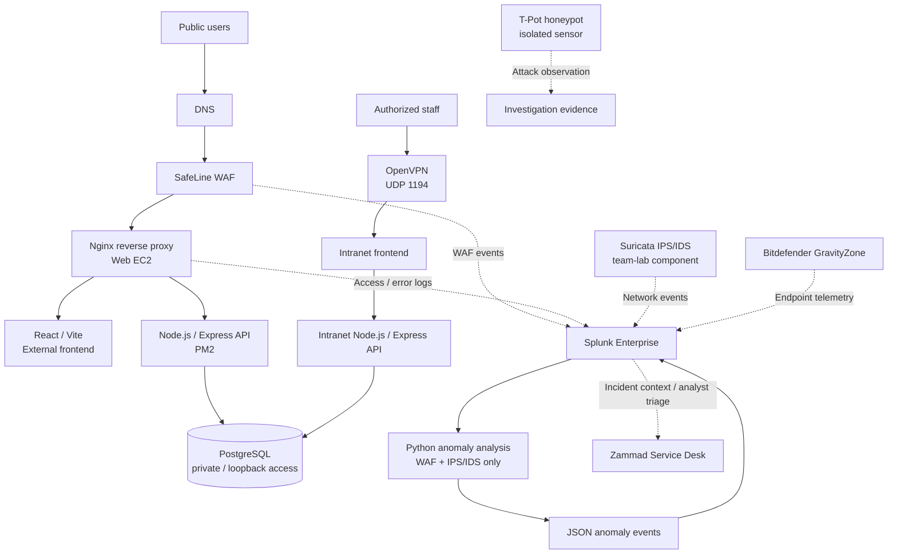
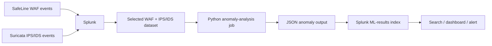

# Apex Enterprise Cybersecurity Lab

**An enterprise-style, hands-on cybersecurity lab** covering secure infrastructure, cloud-hosted services, web and endpoint defense, network monitoring, identity and remote access, centralized security operations, incident handling, and security analytics.

> **Project type:** Enterprise-style cybersecurity infrastructure and defense lab  
> **Environment:** AWS EC2, Ubuntu Linux, Windows endpoints/servers, web services, and separate security-tool instances  
> **Documentation:** English  
> **Security note:** Live IP addresses, credentials, private keys, VPN profiles, tokens, raw logs, and production secrets are intentionally omitted.

## Overview

The lab combines secure application infrastructure with layered defensive controls and security operations workflows. SOC capabilities are one part of the wider environment, alongside cloud and web infrastructure, endpoint/network defense, identity and remote access, and security analytics. The public-facing web service is placed behind a Web Application Firewall (WAF) and Nginx reverse proxy. A separate intranet is intended for authorized users connected through OpenVPN. Application identities are stored in PostgreSQL, passwords are hashed, and Node.js services are supervised by PM2.

Security telemetry is reviewed in Splunk. The wider team lab also covers endpoint protection, network intrusion detection/prevention, a honeypot, ticket-based incident handling, and a Python anomaly-detection pipeline focused on **WAF and IPS/IDS events**.

This is an educational enterprise-style lab, not a claim that the environment is a fully production-hardened enterprise deployment.

## Architecture



This is a **logical overview**, not a literal public network map. Confirm the current deployment and actual log routes before describing an integration as fully operational.

## Main Components

| Area | Technology | Purpose |
|---|---|---|
| Cloud infrastructure | AWS EC2, Ubuntu | Hosts separated application and security-tool instances |
| Web perimeter | SafeLine WAF, Nginx | Filters HTTP traffic and routes requests to application services |
| External application | React, Vite, Node.js, Express | Public portal, registration, login, and API endpoints |
| Internal application | React, Node.js, Express | Teacher/admin intranet intended to be reached through VPN |
| Authentication/data | PostgreSQL, bcrypt, JWT | Stores user records, hashes passwords, supports authenticated API access |
| Process management | PM2, systemd | Manages Node.js and host services |
| Remote access | OpenVPN | Provides a private route to intranet resources |
| Transport security | Let's Encrypt, Certbot, HTTPS | Encrypts web traffic |
| Host/web protection | UFW, AWS Security Groups, Fail2Ban | Limits exposure and blocks repeated suspicious activity |
| Endpoint security | Bitdefender GravityZone XDR | Central endpoint visibility and protection policies |
| Network security | Suricata IPS/IDS | Detects or blocks selected network traffic; wider team-lab component |
| Threat observation | T-Pot honeypot | Records interactions with decoy services |
| SIEM | Splunk Enterprise | Central search, dashboards, and alerting for ingested telemetry |
| Incident handling | Zammad Service Desk | Ticket templates, SLA workflow, TP/FP classification |
| Analytics | Python anomaly detection | Analyzes selected WAF and IPS/IDS events and returns JSON results to Splunk |
| Assessment evidence | Trivy / Nessus evidence | Supporting dependency/filesystem and scanning evidence where documented |

## Security Controls

- **Password storage:** application passwords are hashed with bcrypt; plaintext passwords must never be stored or committed.
- **Input validation:** weak or malformed registration values are rejected by the backend.
- **Database exposure:** PostgreSQL is intended to be private/loopback-only, not publicly reachable.
- **Reverse proxy:** Nginx handles web entry points and forwards required application paths.
- **Network separation:** intranet access is intended to be restricted through OpenVPN.
- **HTTPS:** certificates are managed through Let's Encrypt/Certbot.
- **Abuse protection:** Fail2Ban rules monitor repeated login failures, registration abuse, and repeated 403/404 activity.
- **Endpoint policies:** Bitdefender GravityZone provides centrally managed endpoint protection and policy visibility.
- **Telemetry scope:** the ML workflow is intended to analyze WAF and IPS/IDS logs, not web or XDR logs.
- **Secret handling:** `.env`, `.ovpn`, private keys, tokens, database backups, and sensitive raw logs are excluded from this repository.

## Log and ML Workflow



The project documentation uses `apex:ml:waf_ips` for the ML anomaly-event sourcetype. The intended ML scope is WAF and IPS/IDS telemetry only. This README does not claim measured detection accuracy or performance results.

## Repository Layout

```text
.
├── README.md
├── SECURITY.md
├── .gitignore
├── docs/
│   ├── architecture.md
│   ├── log-pipeline.md
│   ├── data-model.md
│   ├── security-controls.md
│   ├── services-and-ports.md
│   ├── deployment-runbook.md
│   ├── evidence-guide.md
│   ├── presentation-notes-az.md
│   └── diagrams/
│       ├── architecture.mmd
│       ├── log-pipeline.mmd
│       └── database-schema.mmd
├── evidence/README.md
├── scripts/README.md
└── config/README.md
```

Only add source code, scripts, screenshots, and configuration files after removing secrets and validating that they are safe to publish.

## Individual and Team Scope

The project report identifies these areas as Yusif's documented implementation scope: web server, SafeLine WAF, T-Pot honeypot, Bitdefender GravityZone XDR, XDR policies, Zammad ticketing, and machine-learning integration. The wider team lab also documents Active Directory/GPO hardening, Kerio Connect, Splunk SIEM/dashboards, Suricata IPS/IDS, and additional scanning work.

Keep attribution precise: distinguish work you personally implemented from components configured by a teammate or jointly tested.

## Scope and Validation Notes

The architecture diagram is a logical view of the lab, not a literal network map. Exact log routes, index names, listening ports, and automation behavior depend on the active deployment configuration. Where evidence is available, use screenshots, sanitized search results, or configuration excerpts to demonstrate that a control or integration is operating.

This repository is documentation-first: it contains project explanations and diagrams, not a one-command deployment or a complete export of live configuration. No detection-accuracy, event-volume, or response-time metrics are claimed here.

## Evidence

Use [`evidence/README.md`](evidence/README.md) and [`docs/evidence-guide.md`](docs/evidence-guide.md) for screenshot naming and redaction. Group evidence by topic instead of placing every screenshot in one folder.

## Deployment Notes

This repository is documentation-first. It does **not** claim one-command deployment or Infrastructure-as-Code provisioning. The lab was assembled and configured on AWS instances using the documented Linux services. See [`docs/deployment-runbook.md`](docs/deployment-runbook.md).

## Disclaimer

For educational and authorized defensive testing only. Do not test against systems without permission. Public repository content must not include credentials, private keys, VPN profiles, raw personal data, or sensitive live-infrastructure details.
