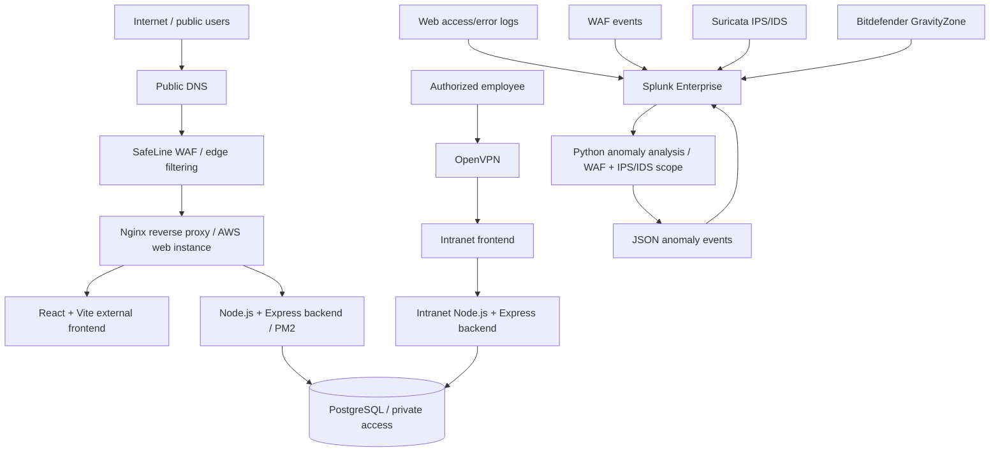

# Architecture and Network Segmentation

## Design Goals

1. Separate the public web application from the internal teacher/admin intranet.
2. Put web traffic through a WAF and reverse proxy.
3. Keep application backends and PostgreSQL away from direct public access.
4. Restrict intranet access to authorized VPN clients.
5. Centralize selected security telemetry in Splunk.
6. Analyze WAF and IPS/IDS events and return anomaly results to Splunk.

## Logical Topology

## Trust Boundaries

- **Public edge:** public DNS and the WAF-facing web entry point.
- **Application tier:** Nginx and Node.js/Express; backend ports should not be exposed directly to the internet.
- **Data tier:** PostgreSQL should accept connections only from authorized local/private services.
- **Remote access:** OpenVPN provides the route to the intranet; VPN access does not replace application authentication.
- **Monitoring tier:** restrict Splunk management and ingestion interfaces to approved sources.
- **Decoy tier:** keep T-Pot isolated from production data and never store sensitive credentials on it.

## Accuracy Notes

This is a logical architecture, not a verified AWS subnet/security-group export. Confirm each log route before marking it operational. The ML input scope is WAF + IPS/IDS; web and XDR logs are not intended to be part of that dataset. Update this diagram if services move to different instances or ports.
