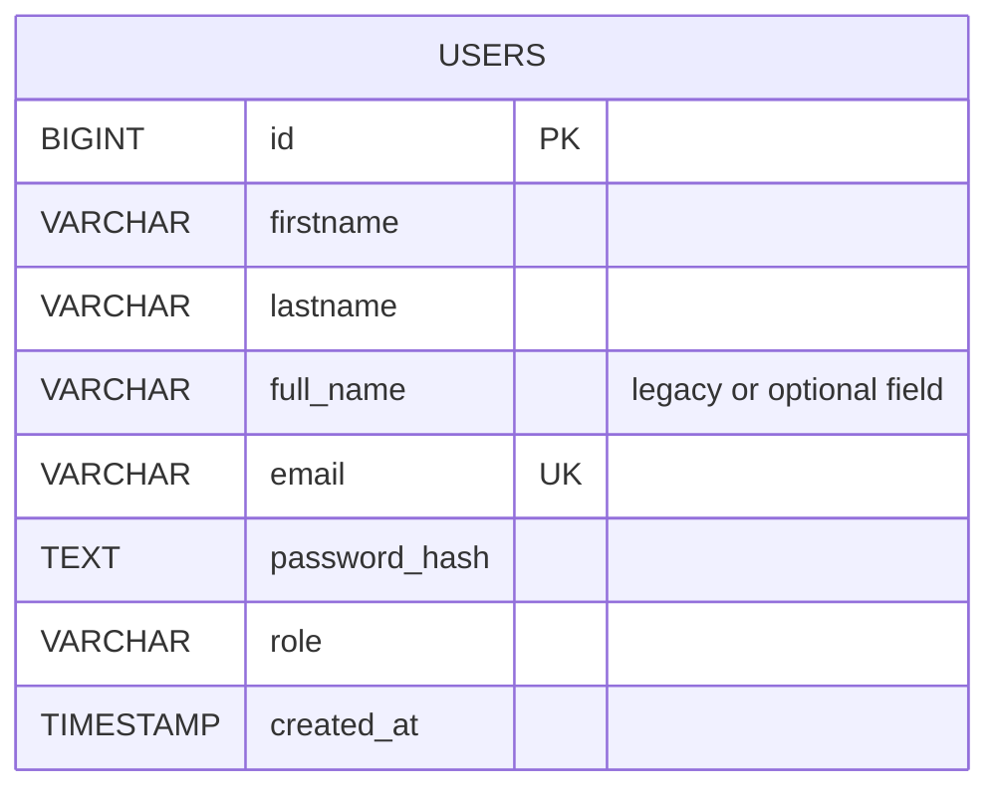

# Application Data Model

The application uses PostgreSQL for registered user records. Passwords must be hashed by the backend before storage; plaintext passwords must never be stored.

## Conceptual `users` Table

The report records `id`, `email`, `password_hash`, `role`, and `created_at`; the deployed backend history also references name fields. Some versions may contain both `full_name` and split first/last-name columns. **Verify the live schema before treating this diagram as an exact migration.**

## Security Rules

- Hash passwords with bcrypt before insertion and verify them with the library's compare function at login.
- Never return `password_hash` in API responses.
- Enforce unique email/username constraints where appropriate.
- Validate registration inputs on the backend, not only in the browser.
- Use parameterized database queries.
- Store DB credentials in a protected environment file or secret manager, not source control.
- Keep PostgreSQL on loopback/private interfaces and restrict cloud firewall access.

## Safe Schema Verification

On an authorized server, inspect the table with `\d+ users` in `psql`. Do not include database passwords or connection strings in screenshots or public documentation.
