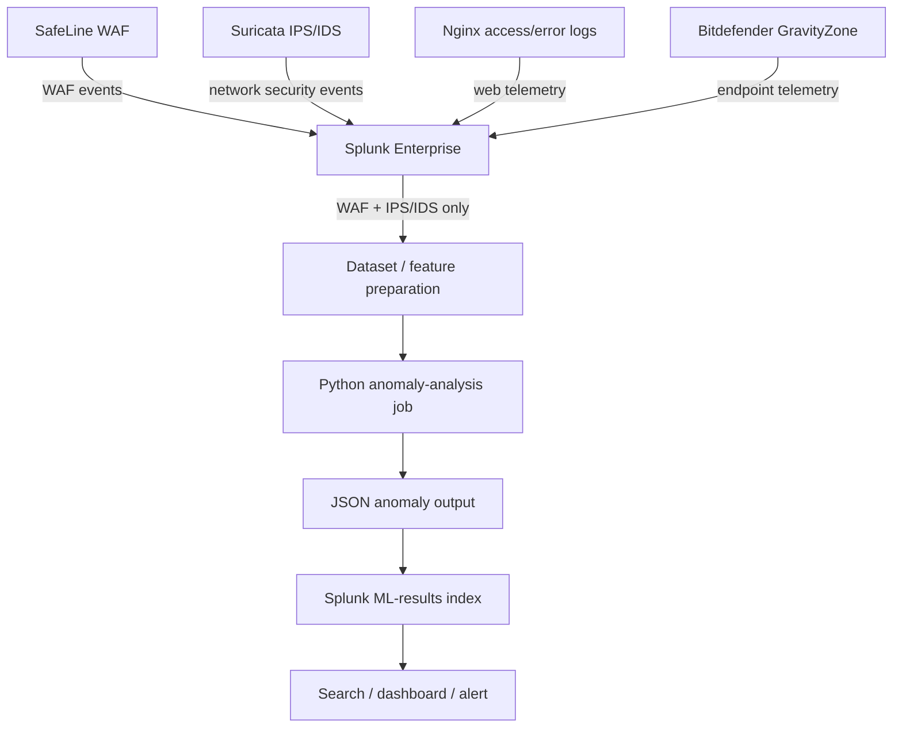

# SIEM and Machine-Learning Log Pipeline

## Intended Flow

## Source Scope

| Source | Purpose | ML input? | Verification |
|---|---|---:|---|
| SafeLine WAF | Web-attack and WAF-rule events | Yes | Confirm exact index name and active ingestion |
| Suricata IPS/IDS | Network detection/prevention events | Yes | Confirm events arrive and index is not empty |
| Nginx web logs | Access and error troubleshooting | No | Keep separate from ML dataset |
| Bitdefender XDR | Endpoint security telemetry | No | Keep separate from ML dataset |
| Python anomaly output | Model findings in JSON | Output only | Check for duplicate events |
| Zammad | Incident tracking | Not a log source by default | Verify whether automated ticket integration exists |

## Index / Sourcetype Names to Verify

| Logical dataset | Name noted in project history |
|---|---|
| Web logs | `WEB` |
| SafeLine WAF logs | `WAF` — confirm exact capitalization and ingestion status |
| XDR logs | `XDR` |
| Suricata IPS/IDS | `ids` or final configured equivalent |
| ML anomaly results | `ml_results` |
| ML output sourcetype | `apex:ml:waf_ips` |

These are documentation references, not a substitute for checking the current Splunk configuration. Index spelling/capitalization must match the live instance.

## Operational Checks

1. Search each source index and confirm the newest event timestamp is recent.
2. Check WAF and IPS/IDS fields before feature extraction.
3. Keep ML input restricted to WAF + IPS/IDS as required by the project brief.
4. Check the scheduled job and system logs if events stop appearing.
5. Compare event counts before and after the ML job to detect duplicate ingestion.
6. Compare dashboard counts with the underlying searches.
7. Do not claim reduced false positives without a reproducible evaluation.

Never commit Splunk HEC tokens, admin credentials, raw sensitive logs, or host-specific secrets.
